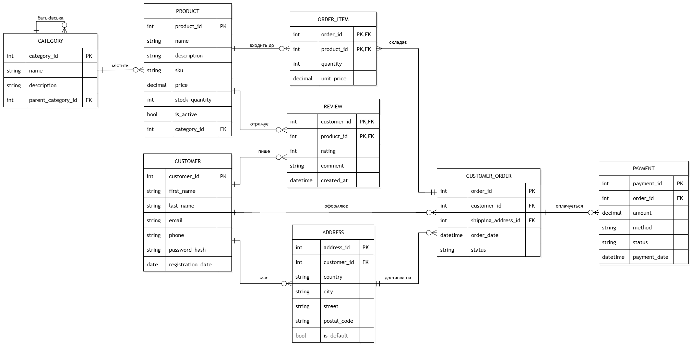

Лабораторна робота 1: Інтернет-магазин

Потреби зацікавлених сторін
- Клієнт може переглядати товари за категоріями, оформлювати замовлення, вибирати адресу доставки, оплачувати, переглядати історію замовлень та залишати відгуки;
- Менеджер магазину має керувати каталогом і залишками, обробляти замовлення та оновлювати їхні статуси;
- Власник має отримувати статистику (дохід за період, найпопулярніші товари та категорії, середній чек).

Бізнес-правила
- Товар належить одній категорії. Категорії можуть містити підкатегорії (Електроніка -> Смартфони);
- Клієнт може мати декілька адрес доставки;
- Замовлення призначається одному клієнту і доставляється на одну з його адрес;
- Замовлення містить один або декілька товарів з кількістю та ціною на момент покупки;
- Ціна товару може змінюватися, але в старих замовленнях ціна залишається історичною;
- Кількість товару в замовленні не може перевищувати залишок на складі;
- Статус замовлення: 'new', 'paid', 'shipped', 'delivered', 'cancelled';
- За одне замовлення може бути декілька спроб оплати (наприклад, перша невдала);
- Відгук може залишити лише клієнт, який купував цей товар. Один клієнт залишає один відгук на товар, оцінка від 1 до 5;
- Електронна адреса клієнта унікальна.

Сутності та атрибути
- Category ('category_id' (PK), 'name', 'description', 'parent_category_id' (FK));
- Product ('product_id' (PK), 'category_id' (FK), 'name', 'description', 'sku', 'price', 'stock_quantity', 'is_active');
- Customer ('customer_id' (PK), 'first_name', 'last_name', 'email', 'phone', 'password_hash', 'registration_date');
- Address ('address_id' (PK), 'customer_id' (FK), 'country', 'city', 'street', 'postal_code', 'is_default');
- Customer_Order ('order_id' (PK), 'customer_id' (FK), 'shipping_address_id' (FK), 'order_date', 'status');
- Order_Item ('order_id' (PK, FK), 'product_id' (PK, FK), 'quantity', 'unit_price');
- Payment ('payment_id' (PK), 'order_id' (FK), 'amount', 'method', 'status', 'payment_date');
- Review ('customer_id' (PK, FK), 'product_id' (PK, FK), 'rating', 'comment', 'created_at').

Зв'язки та кардинальність
- Category - Category: 1 to n (категорія може мати багато підкатегорій, а підкатегорія має одну батьківську; для кореневих категорій батьківської немає);
- Category - Product: 1 to n (категорія містить багато товарів, а товар належить одній категорії);
- Customer - Address: 1 to n (клієнт може мати кілька адрес доставки, адреса належить одному клієнту);
- Customer - Customer_Order: 1 to n (клієнт може оформити багато замовлень, кожне замовлення належить одному клієнту);
- Address - Customer_Order: 1 to n (одна адреса може використовуватися для доставки багатьох замовлень, кожне замовлення має рівно одну адресу доставки);
- Customer_Order - Product: m to n (замовлення містить кілька товарів, один і той самий товар можуть купувати в різних замовленнях) - зв'язок розв'язується асоціативною сутністю 'Order_Item' з атрибутами 'quantity' та 'unit_price';
- Customer_Order - Payment: 1 to n (замовлення може мати кілька спроб оплати, кожен платіж стосується одного замовлення);
- Customer - Product: m to n (клієнт може оцінити багато товарів, товар може мати відгуки багатьох клієнтів) - зв'язок розв'язується асоціативною сутністю 'Review'.

Припущення та обмеження
- Товар належить лише одній категорії. Якщо знадобиться кілька, потрібна буде окрема таблиця 'Product_Category' m to n;
- 'unit_price' в 'Order_Item' не є дублюванням 'Product.price' тому що це ціна продукту в момент його придбання інакше старі замовлення зміняться згідно ціни.
- Загальна сума замовлення не зберігається окремо, її можна порахувати як 'SUM(quantity × unit_price)';
- Статус замовлення приймає одне з фіксованих значень: 'new', 'paid', 'shipped', 'delivered', 'cancelled';
- Для платежу передбачено методи: 'card', 'paypal', 'cash_on_delivery';
- Статус платежу може бути 'pending', 'success', 'failed' або 'refunded';
- Адреса доставки замовлення повинна належати клієнту, який оформив це замовлення;
- Замовлення не може бути порожнім (містить щонайменше одну позицію);
- Кількість товару в замовленні не може перевищувати залишок на складі (перевіряється тригером або логікою застосунку);
- Відгук може залишити лише клієнт, який купував цей товар (перевіряється тригером або логікою застосунку);
- Оплата зберігає лише метод і статус, реальні номери карток не зберігаються;
- Пароль зберігається лише у вигляді хешу.

ER-діаграма

